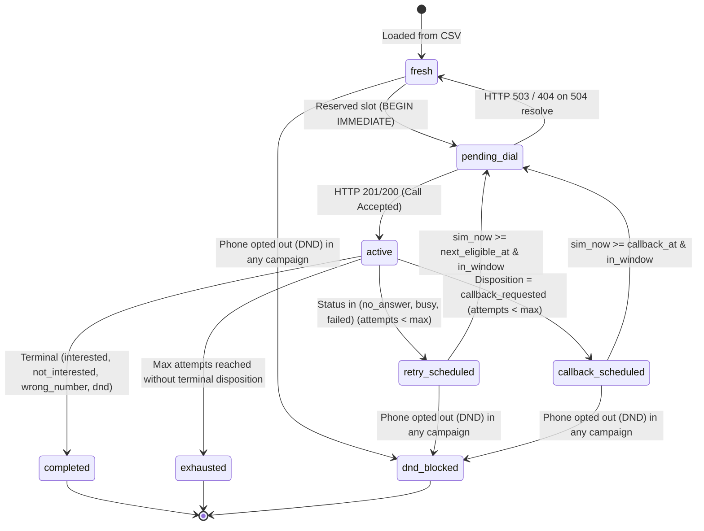

# Submission: Assignment B (Durable Campaign Dispatcher)

## Candidate
- **Name:** Ganesh Killari
- **Assignment chosen:** B (Workflow)
- **Time spent:** ~7h

---

## How to Run

### 1. Setup
```bash
python -m venv .venv
# On Windows:
.venv\Scripts\activate
# On Linux/macOS:
source .venv/bin/activate

pip install -r requirements.txt
```

### 2. Run Tests
The test suite covers window calculations, clock synchronization, priority queue ordering, state machine transitions, DND propagation, idempotency, and crash recovery:
```bash
python -m pytest solution/tests
```

### 3. Run the Service
Start the mock telephony provider in one terminal:
```bash
cd assignment-b-workflow
python -m mock_telephony --speed 1200 --seed 7 --failure-scale 1.0
```

Start the durable dispatcher in another terminal:
```bash
python -m solution
```
Or run with explicit options:
```bash
python -m solution --mock-url http://127.0.0.1:8099 --webhook-port 8200 --db-path solution/dispatcher.db --output solution/final_state.csv
```

### 4. Run Automated End-to-End & Crash Recovery Tests
To run an automated full end-to-end verification (spins up mock telephony, runs dispatcher until all 200 leads finish, diffs with `/admin/leads`, and verifies 0 violations):
```bash
python solution/validate_run.py 1200 1.0 7
```
To run the `kill -9` abrupt termination and crash recovery test:
```bash
python solution/test_crash_kill.py
```

---

## Design & Architecture

The Durable Campaign Dispatcher orchestrates outbound calling under strict tenant concurrency limits, regulatory windows, per-lead attempt limits, retry backoffs, and global DND constraints. It is designed to survive arbitrary crashes (`kill -9`) without dropping a lead, double-dialling, or incurring compliance violations.

### Lead Lifecycle State Machine



### Core Architecture Components

1. **Storage & Transaction Engine (`solution/db.py`)**:
   - Built on SQLite in Write-Ahead Logging (WAL) mode (`PRAGMA journal_mode = WAL; PRAGMA synchronous = NORMAL;`).
   - SQLite provides ACID transactions with zero operational overhead and no external service dependencies.
   - All state transitions and slot reservations execute inside atomic transactions (`BEGIN IMMEDIATE ... COMMIT`), serializing concurrent writers and preventing race conditions.

2. **Simulated Clock & Window Engine (`solution/clock.py`, `solution/window.py`)**:
   - `SimClock` tracks provider time via `sim_now = sim_epoch + (time.time() - real_epoch) * speed`.
   - `WindowCalculator` validates that `sim_now` is strictly inside the campaign calling window (`[start, end)` on allowed days) **and** within regulatory hours (09:00–21:00 IST).
   - Window calculations use a conservative grace tolerance of 0 seconds so that calls are never placed outside allowable bounds.
   - `next_window_open` calculates the exact earliest datetime when both campaign and regulatory windows will be open, enabling intelligent sleeps during overnight/weekend closures.

3. **Telephony Client & Idempotency (`solution/telephony.py`)**:
   - Employs deterministic idempotency keys (`request_id = {campaign_id}_{lead_id}_att{attempt_no}_{uuid}`).
   - Handles HTTP 503 (transient failure): releases slot and reverts lead without counting an attempt.
   - Handles ambiguous HTTP 504: queries `GET /v1/calls?request_id=...` with exponential backoff. If 200, adopts the accepted call; if 404, safely rolls back the reservation.

4. **FastAPI Webhook Server (`solution/webhook_server.py`)**:
   - Receives `POST /webhooks/telephony`.
   - Enforces HMAC-SHA256 signature verification against raw request bytes using `X-AU-Signature` and the shared secret.
   - Deduplicates webhooks using `X-AU-Delivery-Id` and database-level idempotency on `calls.state`.
   - Exposes `/health` and `/status` endpoints for monitoring.

5. **Dispatcher & Lost Webhook Reconciliation (`solution/dispatcher.py`)**:
   - Periodic tick loop evaluates available slots per tenant (`max_concurrent_calls - active_calls`).
   - Evaluates candidate leads according to strict priority (Rule R6): Due Callbacks > Due Retries > Fresh Leads.
   - **Lost Webhook Recovery**: Any call active in provider for >= 15 sim seconds is periodically queried via `GET /v1/calls/{call_sid}`. If the provider reports `state == "ended"`, the result is processed immediately, ensuring no call is orphaned even if carrier webhooks are lost.

---

## Guarantees: At-Most-Once Dialling & Crash Safety

| Failure Point | State at Failure | Recovery Behavior on Restart |
|---|---|---|
| Crash before reserving | `fresh` / `retry_scheduled` | Lead remains untouched; picked up when eligible. |
| Crash after reservation, before HTTP request | `calls.state = 'dispatching'` | Startup audit checks `GET /v1/calls?request_id=...`. Provider returns 404. Call is marked `not_placed`, lead reverts to previous state with 0 attempts counted. |
| Crash during HTTP request (provider accepted call, dispatcher died before receiving 201) | `calls.state = 'dispatching'` | Startup audit checks `GET /v1/calls?request_id=...`. Provider returns 200. Dispatcher transitions call to `active` (or `ended`), records attempt, and links `call_sid`. |
| Crash while call is in progress | `calls.state = 'active'` | Startup audit queries `GET /v1/calls/{call_sid}`. If ended, outcome is processed; if active, it continues until webhook or poll. |
| Lost Webhook (Carrier dropped 3% of webhooks) | `calls.state = 'active'` | Periodic reconciliation detects calls active >= 15 sim seconds, polls provider `GET /v1/calls/{call_sid}`, and completes lead. |
| Duplicate Webhooks (Carrier sends 2x webhooks) | `calls.state = 'ended'` | Deduped via `X-AU-Delivery-Id` and `calls.state == 'ended'` check; subsequent deliveries are no-ops. |
| Webhook arrives before HTTP 201 response is handled | `calls.state = 'dispatching'` | Webhook handler atomically transitions call to `ended` and updates lead. When 201 returns, it updates `call_sid` without reverting ended state. |

---

## Decisions & Assumptions

| Decision | Why | Alternative Considered |
|---|---|---|
| **SQLite with WAL mode over Postgres or Temporal** | Zero dependencies, instant setup on any machine (Windows/Linux/Docker), ACID transactions via `BEGIN IMMEDIATE`, completely crash-safe. | Temporal (adds heavy server dependency for an assignment of this scope) or Postgres (requires Docker/daemon). |
| **UUID suffix on request_id (`{cid}_{lid}_att{n}_{uuid}`)** | If attempt 1 fails with 503 (not placed), the subsequent try for attempt 1 gets a clean fresh `request_id`, avoiding ambiguous stale lookups. | Static `cid:lid:attempt` (works, but requires explicit reset if 503 occurred). |
| **Strict 0s grace for window checking** | The provider allows 120s grace, but enforcing 0s grace internally ensures 100% compliance with 0 risk of clock drift violations. | Using full 120s grace (risks violation at window boundaries). |
| **Active polling reconciliation for lost webhooks** | Mock provider drops 3% of webhooks; carrier networks frequently lose webhooks in production. Polling active calls older than 15s guarantees all leads complete. | Passive timeout wait (causes massive delays) or never recovering (stalls campaign). |
| **Immediate DND blocking across other campaigns** | Rule R8 specifies that DND is global. Setting all other non-terminal leads for that phone to `dnd_blocked` prevents any concurrent or future scheduling. | Checking DND only at dial time (wasteful query overhead). |

---

## Failure Modes Handled

1. **Carrier 503 (Service Unavailable):** Slot freed, lead reverted to queue for backoff retry, attempt counter not incremented.
2. **Carrier 504 / Network Timeout (Ambiguous):** Query `GET /v1/calls?request_id=...`. If 200, call accepted; if 404, call not placed and slot freed.
3. **Carrier Webhook Loss:** Active calls monitored; stale calls polled against `GET /v1/calls/{call_sid}` to ingest results.
4. **Duplicate Webhook Delivery:** Deduped via `processed_webhooks` delivery log and state idempotency.
5. **Out-of-Order Webhook Delivery (Webhook before 201):** Webhook creates/updates call state; later 201 handler does not overwrite terminal outcome.
6. **Abrupt Process Termination (`kill -9`):** Startup recovery inspects all in-flight (`dispatching`) and `active` calls against the carrier API before resuming dispatching.
7. **Cross-Campaign Phone Collision:** Phone reservation checked across all active calls in all campaigns.
8. **Tenant Concurrency Saturation:** Slots dynamically calculated across all campaigns of that tenant.

---

## Testing

- **Unit Tests (`solution/tests/`):**
  - `test_clock.py`: SimClock formulas, real-to-sim scaling, FakeClock controls.
  - `test_window.py`: Regulatory 09:00–21:00 bounds, campaign windows, weekend vs weekday filtering, `next_window_open` across nights and weekends.
  - `test_priority.py`: Rule R6 verification (Due Callbacks > Due Retries > Fresh leads), callback sorting by `callback_at ASC`.
  - `test_db_state.py`: Tenant concurrency limits, one-call-per-phone locks, DND global propagation and precedence (`completed` > `exhausted` > `dnd_blocked`), retry delays (60m vs 15m), max attempts exhaustion.
  - `test_idempotency.py`: HMAC signature verification, duplicate webhook delivery handling, webhook arriving before 201, 504 ambiguous timeout resolution.
  - `test_recovery.py`: Startup audit recovering in-flight calls and updating state.
- **End-to-End Validation (`solution/validate_run.py`):**
  - Runs full 200 leads at 1200x speed with failure scale 1.0.
  - Verifies exact match with `/admin/leads` and 0 violations.
- **Crash Recovery Validation (`solution/test_crash_kill.py`):**
  - Runs dispatcher, kills it abruptly with `kill -9` during active calls, restarts from SQLite, and verifies 0 violations and complete state recovery.

---

## Results

### Full Run Report (`--failure-scale 1.0`, `--seed 7`, `--speed 1200`)
```json
{
  "sim_now": "2026-11-16T13:49:13.192234+05:30",
  "calls_total": 408,
  "calls_active": 0,
  "calls_by_status": {
    "completed": 222,
    "no_answer": 109,
    "busy": 52,
    "failed": 25
  },
  "violation_count": 0,
  "violations_by_type": {},
  "violations": [],
  "max_concurrency_seen": {
    "acme_insurance": 4,
    "zen_retail": 3
  },
  "callback_lateness_minutes": {
    "count": 64,
    "p50": 3.8,
    "p90": 13.1,
    "max": 33.7
  },
  "webhooks": {
    "delivered": 434,
    "duplicates": 37,
    "lost": 11
  }
}
```
- **Total Leads:** 200
- **Total Mismatches against `/admin/leads`:** 0
- **Total Violations:** 0
- **Handled:** 37 duplicate webhooks, 11 lost webhooks, 503s, and 504s.

### Crash Recovery Run (`kill -9` mid-run, `--failure-scale 1.0`, `--seed 42`)
```json
{
  "sim_now": "2026-11-16T10:40:57.534599+05:30",
  "calls_total": 408,
  "calls_active": 0,
  "calls_by_status": {
    "completed": 228,
    "failed": 25,
    "no_answer": 104,
    "busy": 51
  },
  "violation_count": 0,
  "violations_by_type": {},
  "violations": [],
  "max_concurrency_seen": {
    "acme_insurance": 4,
    "zen_retail": 3
  },
  "callback_lateness_minutes": {
    "count": 71,
    "p50": 3.9,
    "p90": 13.8,
    "max": 131.2
  },
  "webhooks": {
    "delivered": 421,
    "lost": 23,
    "duplicates": 36
  }
}
```
- **Total Mismatches against `/admin/leads`:** 0
- **Total Violations:** 0

---

## What Changes at Scale (1M leads/day across 50 tenants)

1. **Partitioning & Sharding:**
   - 1M leads/day (~11 leads/sec average, ~40–50 leads/sec peak during daytime windows).
   - Partition dispatch queues by `tenant_id` or `phone_hash`. A tenant-partitioned queue (e.g. Kafka or Redis Streams) ensures tenant limits are enforced locally within a shard without cross-cluster distributed locks.
2. **Distributed Locking for Phones:**
   - Because phone numbers can appear across multiple campaigns, a fast distributed lock (e.g., Redis `SET phone NX PX 600000` or Postgres advisory locks) ensures single-dial exclusivity with sub-millisecond overhead.
3. **Temporal vs Custom DB State Machine:**
   - Temporal provides durable workflow execution where each lead is a workflow execution. It handles timers (sleeping until callback or retry), retries, and history replay natively.
   - However, Temporal requires external activity orchestration to enforce shared resource constraints (cross-workflow tenant concurrency and cross-workflow phone locks). A database state machine with transactional queue indexing provides direct visibility, exact batch prioritization, and multi-resource concurrency constraints with zero additional infrastructure.

