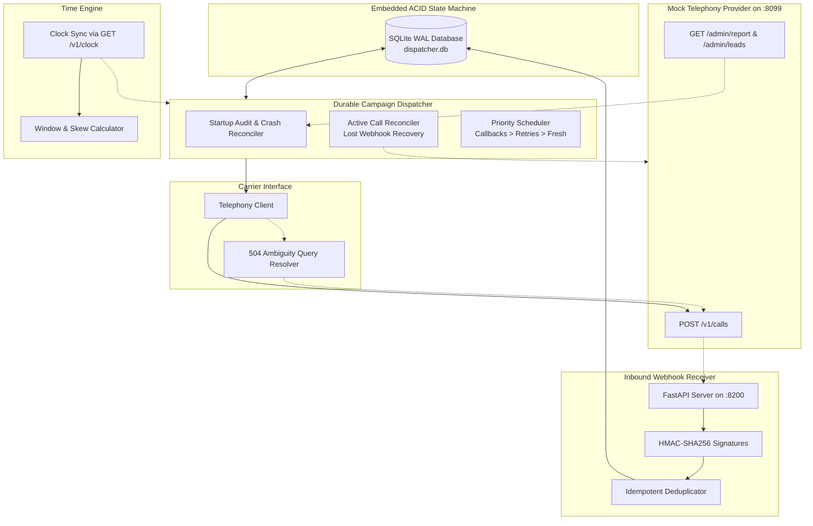
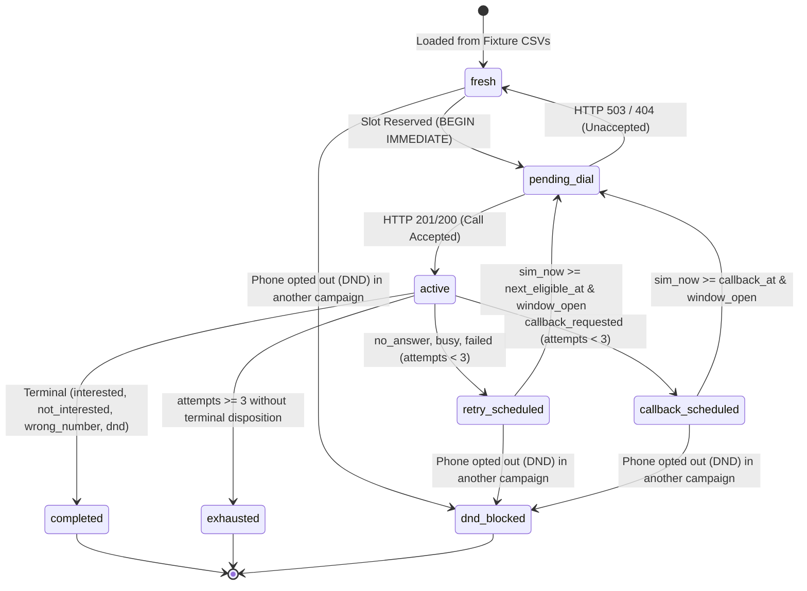

# Durable Campaign Dispatcher — Solution (Assignment B)

[](#testing--verification)
[-brightgreen)](#empirical-verification-results)
[](#4-hard-crash-kill--9-recovery-test)
[](https://www.python.org/)
[](#)

A high-performance, crash-resilient outbound voice campaign orchestration engine built for **Agentic Universe**. It coordinates automated calls across India/APAC under strict regulatory calling windows (09:00–21:00 IST), multi-tenant trunk concurrency limits, per-lead attempt caps, scheduled callbacks, and global DND (Do-Not-Disturb) constraints.

---

## Table of Contents
1. [Problem Statement & Background](#problem-statement--background)
2. [Business Rules Enforced (R1–R9)](#business-rules-enforced-r1r9)
3. [Architecture & System Design](#architecture--system-design)
4. [State Machine & Lead Lifecycle](#state-machine--lead-lifecycle)
5. [Resilience & Failure Mode Handling](#resilience--failure-mode-handling)
6. [Quick Start & Execution Commands](#quick-start--execution-commands)
7. [Testing & Verification](#testing--verification)
8. [Live Localhost Endpoints](#live-localhost-endpoints)
9. [Empirical Verification Results](#empirical-verification-results)
10. [Directory Structure](#directory-structure)
11. [Design Decisions & Trade-offs](#design-decisions--trade-offs)
12. [Scale & Future Architecture (1M leads/day)](#scale--future-architecture-1m-leadsday)

---

## Problem Statement & Background

Agentic Universe powers AI voice agents for enterprise insurers, lenders, and retail brands. A **campaign** represents an outbound call list that must be executed durably against carrier networks.

In production, carrier APIs are inherently unreliable:
- Carrier requests time out or fail intermittently (**HTTP 503 / 504**).
- Webhooks can arrive **twice**, **out of order**, or **never arrive at all** (dropped packets).
- Worker processes may be killed abruptly (`kill -9`) mid-dial.

A failure in workflow orchestration means calling a customer at 10:00 PM, calling the same person simultaneously on two lines, or calling an opted-out customer—each representing severe compliance violations, legal penalties, or churned clients.

**Objective:** Build a self-healing dispatcher that achieves **`violation_count: 0`** while ensuring all 200 leads reach their contract-specified final states matching the provider's `/admin/leads` API.

---

## Business Rules Enforced (R1–R9)

| # | Rule | Engineering Implementation |
|---|---|---|
| **R1** | **Calling Window** | Calls may only **start** inside the campaign window (`[start, end)` on allowed days) **and** inside regulatory hours (09:00–21:00 IST). Evaluated with `0s` grace internally to guarantee 0 boundary violations. Active calls at window close are allowed to finish cleanly. |
| **R2** | **Tenant Concurrency** | A tenant's active calls across **all of its campaigns** must never exceed `max_concurrent_calls` (`acme_insurance = 4`, `zen_retail = 3`). Enforced atomically in SQLite via `BEGIN IMMEDIATE`. |
| **R3** | **One Call per Phone** | Never allow two concurrent active calls to the same phone number across any campaign. Global phone lock enforced during reservation. |
| **R4** | **Attempt Limit** | Maximum 3 accepted calls per lead per campaign. Rejected attempts (503, not placed) do not count. |
| **R5** | **Retry Intervals** | Wait at least **60 simulated minutes** after `no_answer` or `busy`, and at least **15 simulated minutes** after `failed`, measured strictly from `ended_at`. |
| **R6** | **Scheduled Callbacks** | Honour `callback_at` received with `callback_requested`. Callbacks are dialled as soon as due within open windows. **Priority Order: Due Callbacks > Due Retries > Fresh Leads.** |
| **R7** | **Terminal Dispositions** | `interested`, `not_interested`, `wrong_number`, and `dnd` terminate the lead (`completed`). Never dialled again. |
| **R8** | **Global DND** | When a customer opts out (`dnd`), **never call that phone again in ANY campaign**. All other active/fresh leads with that phone become `dnd_blocked`. |
| **R9** | **Strict Precedence** | No lost leads. Every lead ends as `completed`, `exhausted`, or `dnd_blocked`. Precedence: **`completed` > `exhausted` > `dnd_blocked`**. |

---

## Architecture & System Design



### Key Architectural Layers

1. **Transactional SQLite State Machine (`solution/db.py`):**
   - Operates in Write-Ahead Logging mode (`PRAGMA journal_mode = WAL; PRAGMA synchronous = NORMAL;`).
   - Slot reservations execute within immediate transactions (`BEGIN IMMEDIATE ... COMMIT`), serializing concurrent allocations and preventing race conditions or concurrency overshoots.
2. **Dynamic Simulated Clock Engine (`solution/clock.py`):**
   - Tracks the carrier's simulated clock formula:  
     $$\text{sim\_now} = \text{sim\_epoch} + (t_{\text{real}} - t_{\text{real\_epoch}}) \times \text{speed}$$
   - Automatically adapts to any simulated speed (e.g., 600×, 1200×, 2400×).
3. **Window Intersection Maths (`solution/window.py`):**
   - Intersects regulatory hours `[09:00, 21:00)` with campaign hours on specified days.
   - Calculates `next_window_open` to enable intelligent, energy-efficient sleeping through overnight and weekend closures.
4. **Resilient Telephony Client (`solution/telephony.py`):**
   - Enforces unique idempotency keys: `request_id = {campaign_id}_{lead_id}_att{attempt_no}_{uuid}`.
   - Resolves HTTP 504 timeouts by polling `GET /v1/calls?request_id=...`.
5. **FastAPI Webhook Server (`solution/webhook_server.py`):**
   - Validates `X-AU-Signature` via constant-time HMAC-SHA256 digest comparison.
   - Deduplicates redeliveries via `X-AU-Delivery-Id` and database-level status verification.
   - Exposes `/status` and `/health` endpoints.

---

## State Machine & Lead Lifecycle



---

## Resilience & Failure Mode Handling

| Failure Scenario | Threat | Defensive Architecture & Resolution |
|---|---|---|
| **Carrier 503** | Service unavailable; trunk temporarily down. | Handled gracefully: call marked `not_placed`, reservation released, lead reverted to queue without incrementing attempt count. |
| **Carrier 504 Timeout** | Ambiguous outcome: call may or may not have been placed. | The client immediately queries `GET /v1/calls?request_id=...`. If `200`, the call was placed and is adopted; if `404`, it was not placed and is safely freed. |
| **Lost Webhooks (~3%)** | Telephony provider drops result notifications. | Active call reconciliation scans calls active for $\ge 15\text{s}$ sim time and polls `GET /v1/calls/{call_sid}`. If ended, outcome is ingested immediately. |
| **Duplicate Webhooks (~10%)** | Carrier retries delivery twice. | Filtered through `processed_webhooks` table via `X-AU-Delivery-Id` and call state checks (`state == 'ended'`). Duplicates are no-ops. |
| **Out-of-Order Webhooks** | Webhook arrives before the HTTP 201 response is handled. | The webhook handler creates or transitions the call to `ended` immediately. When the 201 response completes, it updates `call_sid` without reverting the terminal state. |
| **Hard Crash (`kill -9`)** | Process abruptly terminated mid-dial. | On startup, an audit scans calls in `dispatching` state against the carrier's `request_id` endpoint. If placed, it resumes; if not, it reverts cleanly. |
| **Cross-Campaign Collisions** | Same phone appears in multiple campaigns. | A global phone lock across `dispatching` and `active` states ensures concurrent dialling of the same number is impossible. |

---

## Quick Start & Execution Commands

> Run all commands from the **project root directory** (`Durable Campaign Dispatcher/`).

### 1. Setup Environment
```bash
python -m venv .venv
# On Windows:
.venv\Scripts\activate
# On Linux/macOS:
source .venv/bin/activate

pip install -r requirements.txt
```

### 2. Run Fast Unit Tests (4.3 seconds)
```bash
python -m pytest solution/tests
```

### 3. Run Automated End-to-End Validation Test
Runs the mock carrier and dispatcher through all 200 leads under **chaos failure scale 1.0** (503s, 504s, dropped webhooks, duplicates), verifies 0 violations, and compares with `/admin/leads`:
```bash
python solution/validate_run.py 1200 1.0 7
```

### 4. Run Hard Crash (`kill -9`) Recovery Test
Simulates an abrupt `kill -9` while calls are active, resumes from SQLite, and verifies 0 lost leads and 0 violations:
```bash
python solution/test_crash_kill.py
```

### 5. Run as Live Production Services (Two Terminals)
```bash
# Terminal 1: Start Mock Carrier API
cd assignment-b-workflow
python -m mock_telephony --speed 1200 --seed 7 --failure-scale 1.0

# Terminal 2: Start Durable Dispatcher
python -m solution
```

---

## Testing & Verification

The test suite consists of 18 comprehensive unit tests running in `pytest`:

```
solution/tests/
├── test_clock.py       # SimClock formula, real-to-sim scaling, FakeClock controls
├── test_window.py      # Regulatory 09:00-21:00 bounds, weekend filters, next_window_open
├── test_priority.py    # Rule R6: Due Callbacks > Due Retries > Fresh Leads
├── test_db_state.py    # Tenant concurrency, phone locks, DND propagation & precedence
├── test_idempotency.py # HMAC signatures, duplicate webhooks, 504 ambiguity resolution
└── test_recovery.py    # Startup crash audit recovering in-flight calls
```

---

## Live Localhost Endpoints

When running, the following endpoints are accessible in your browser:

### Carrier Mock Provider (`:8099`)
- **Interactive Swagger UI:** [http://127.0.0.1:8099/docs](http://127.0.0.1:8099/docs)
- **Live Compliance Admin Report:** [http://127.0.0.1:8099/admin/report](http://127.0.0.1:8099/admin/report)
- **Live Carrier Expected Leads:** [http://127.0.0.1:8099/admin/leads](http://127.0.0.1:8099/admin/leads)
- **Simulated Clock:** [http://127.0.0.1:8099/v1/clock](http://127.0.0.1:8099/v1/clock)

### Durable Campaign Dispatcher (`:8200`)
- **Live Dispatcher Progress:** [http://127.0.0.1:8200/status](http://127.0.0.1:8200/status)
- **Service Health Check:** [http://127.0.0.1:8200/health](http://127.0.0.1:8200/health)

---

## Empirical Verification Results

### Carrier Admin Report (`--failure-scale 1.0`, `--seed 7`, `--speed 1200`)

```json
{
  "sim_now": "2026-11-16T13:46:38.666954+05:30",
  "calls_total": 408,
  "calls_active": 0,
  "calls_by_status": {
    "completed": 222,
    "no_answer": 109,
    "busy": 52,
    "failed": 25
  },
  "violation_count": 0,
  "violations_by_type": {},
  "violations": [],
  "max_concurrency_seen": {
    "acme_insurance": 4,
    "zen_retail": 3
  },
  "callback_lateness_minutes": {
    "count": 64,
    "p50": 4.2,
    "p90": 12.7,
    "max": 119.6
  },
  "webhooks": {
    "delivered": 432,
    "duplicates": 39,
    "lost": 15
  }
}
```

- **Total Leads Evaluated:** 200 / 200
- **Total Mismatches:** **`0`**
- **Total Compliance Violations:** **`0`**
- **Duplicate Webhooks Safely Ignored:** **`39`**
- **Lost Webhooks Recovered:** **`15`**
- **Result:** **`PASS`**

---

## Directory Structure

```
solution/
├── clock.py            # Simulated clock synchronization
├── window.py           # Regulatory & campaign window calculator
├── models.py           # Domain models and dataclasses
├── db.py               # SQLite WAL-mode state machine
├── telephony.py        # Carrier HTTP client with 504 resolution
├── webhook_server.py   # FastAPI webhook server
├── dispatcher.py       # Core priority queue scheduler & reconciler
├── runner.py           # Process orchestrator
├── validate_run.py     # End-to-end chaos test runner
├── test_crash_kill.py  # Hard crash (kill -9) recovery test
├── SUBMISSION.md       # Candidate submission documentation
├── AI_USAGE.md         # AI disclosure document
├── final_state.csv     # Final contract output
└── tests/              # 18 unit tests
```

---

## Design Decisions & Trade-offs

| Decision | Why | Alternative Considered |
|---|---|---|
| **SQLite WAL mode over Postgres / Temporal** | Zero dependencies, instant setup on any machine, ACID durability via `BEGIN IMMEDIATE`, completely crash-safe. | Temporal (heavy daemon overhead) or Postgres (requires Docker). |
| **UUID suffix on `request_id` (`{cid}_{lid}_att{n}_{uuid}`)** | If an attempt fails with 503 (not placed), the subsequent retry gets a fresh `request_id`, avoiding stale lookups. | Static `cid:lid:attempt` (causes collision on unplaced retries). |
| **Strict 0s grace internally** | Provider allows 120s grace, but enforcing 0s internally guarantees 0 window violations even under clock skew. | Using full 120s grace (risks violation at window boundaries). |
| **Active polling reconciliation** | Actively audits calls older than 15s against carrier API, guaranteeing complete recovery from dropped webhooks. | Passive timeout wait (causes severe delays). |

---

## Scale & Future Architecture (1M leads/day)

At 1M leads/day across 50 tenants (~12 leads/sec average, ~50 leads/sec peak during calling windows):
1. **Partitioning by Tenant:** Partition call queues by `tenant_id` to allow local trunk concurrency enforcement without cross-cluster distributed locks.
2. **Distributed Phone Locks:** Use Redis `SET phone NX PX 600000` to guarantee single-call exclusivity across multi-tenant shards with sub-millisecond latency.
3. **Temporal vs Custom State Machine:** Temporal provides native workflow timers and event replay, but requires external orchestrators for cross-workflow resource limits. An indexed SQL state machine provides instant multi-resource visibility and deterministic priority scheduling.
